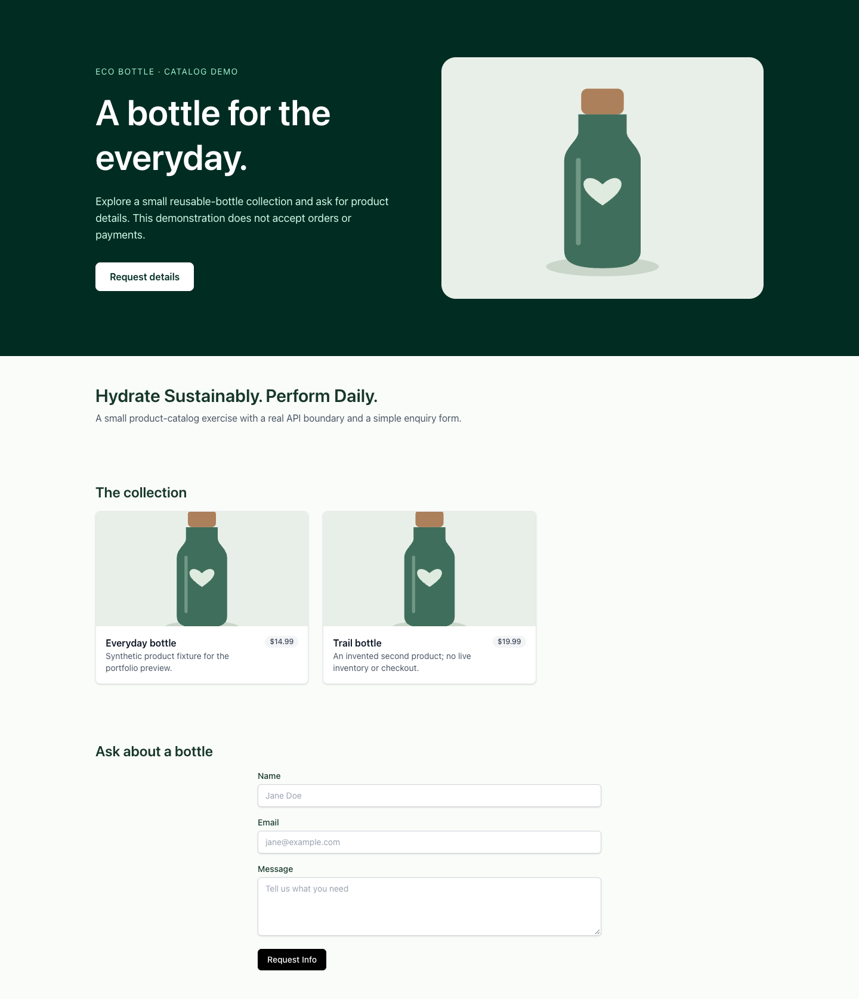
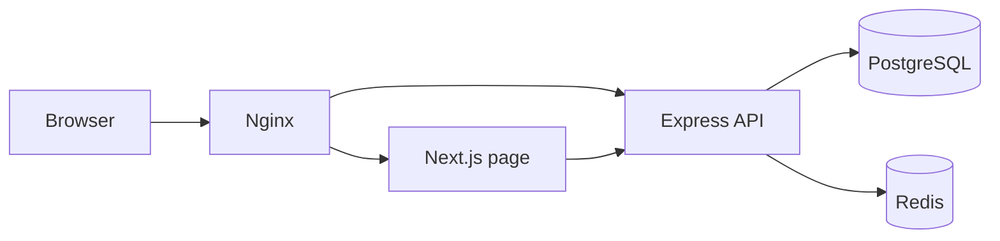

# Eco Bottle: a catalog and enquiry demo

A Next.js landing page connected to an Express API, with PostgreSQL records, Redis caching/rate limiting, and Docker Compose infrastructure. Browse a small bottle catalog and send an enquiry. There is no cart, checkout, payment processing, order fulfillment, or verified sustainability assessment.



[Mobile preview](docs/commerce-mobile.png). Both images use synthetic API fixtures, not a live shop, real customer enquiries, or external product photography.

## Follow one request



Next.js fetches initial catalog data on the server; SWR refreshes it in the browser. The enquiry form validates bounded fields, keeps the draft after failure, and clears it only after a successful response. The hero link moves to the form when clicked; the page no longer scrolls there automatically on load.

The API includes 15-minute JWTs, a Redis logout blacklist, product caching/invalidation, validation, and metrics. Those pieces demonstrate integration boundaries; their presence is not proof of production readiness or performance under load.

## Local development

Node 20.10+ is the declared baseline; checks used Node 22. Each application now has its own npm lockfile. Root pnpm/Artillery tooling is optional and was not installed or executed.

From `apps/backend`:

```sh
npm ci --ignore-scripts --workspaces=false
cp .env.example .env
npm run typecheck --workspaces=false
npm run dev --workspaces=false
```

Before starting, fill `DATABASE_URL`, a private `JWT_SECRET` of at least 32 characters, and `REDIS_URL`. The default host is loopback. PostgreSQL needs a prepared schema; no versioned migrations are currently committed, so do not assume `migration:run` initializes an empty database. Use the explicit disposable Compose initialization below or design a reviewed migration.

From `apps/frontend`:

```sh
npm ci --ignore-scripts --workspaces=false
cp .env.example .env.local
npm run dev --workspaces=false
```

The defaults target the API on port 4000. `NEXT_PUBLIC_API_URL` is public browser configuration fixed at build time; `INTERNAL_API_URL` is the server-side address. No credential belongs in a `NEXT_PUBLIC_*` value.

## Compose: initialize deliberately, preserve data on shutdown

Copy the root `.env.example` to `.env`. Supply your own PostgreSQL password, full database URL for host `postgres`, private signing key, and disposable seed account credentials. URL-encode the database password inside the URL.

For a **new disposable database only**:

```sh
docker compose --profile demo-init run --rm db-init
docker compose --profile demo-init run --rm seed
docker compose up --build
```

The initializer uses TypeORM schema synchronization. It does not intentionally drop the whole schema now, but synchronization can still alter existing tables; it is not a migration strategy. The seed updates demo product rows and only creates its configured account when that email is absent.

Ordinary startup excludes initialization and seeding. Standard shutdown is `docker compose down`; it preserves volumes. Destructive volume deletion is no longer hidden inside the normal pnpm/Make shutdown commands.

Nginx is published on `http://localhost:8080`; database, Redis and Prometheus host ports are loopback-only. Dockerfiles use the component lockfiles and skip install scripts. Compose parsing was checked; images and services were not built or run, so container behavior remains unverified.

## API and policy boundaries

| Endpoint | Contract |
| --- | --- |
| `GET /api/products?page=1&limit=12` | Catalog items and pagination |
| `GET /api/products/:slug` | Product detail |
| `POST /api/leads` | Name, email, required message, optional bounded UTM source |
| `POST /api/auth/register`, `POST /api/auth/login` | Local email/password authentication |
| `POST /api/auth/logout`, `GET /api/auth/me` | Bearer-token session operations |

Product create/update/delete routes are **disabled by default**. The original policy allowed every registered account to modify the catalog. `ENABLE_DEMO_PRODUCT_WRITES=true` restores that shared-demo behavior only; it does not create administrator authorization. An admin policy needs a deliberate implementation before hosting.

Direct backend `/health`, `/metrics`, `/docs` and `/openapi.json` exist, but the checked Nginx config does not publish all of those paths as API routes. The health endpoint reports process liveness, not database/Redis readiness.

The API no longer trusts arbitrary proxy headers by default; behind the current Nginx layout, rate limiting therefore groups requests by proxy address until a trusted proxy policy is configured. Error responses hide unexpected database details, logs redact authorization/cookie headers, and development defaults no longer supply a shared signing key.

## Verification

- Three offline API test groups: product-write default denial, pagination before querying, generic errors.
- Two offline browser-transport tests: fresh abort signal on GET retry; no automatic retry for writes.
- Backend TypeScript check; Next.js production build and ESLint.
- Real Chrome: synthetic server-rendered catalog, working hero link, failed enquiry/draft retention, retry/reset, reduced-motion preference, desktop and 390 px layout.
- Default and explicit-init Compose configuration parsing only.

No PostgreSQL/Redis authentication, cache races, blacklist behavior, real lead persistence, image build, migration, seed, load test, or deployment was exercised. The old CI badge, MIT claim without a license file, and unmeasured latency targets were removed.

Next.js was patched within the 15.5 release line to 15.5.28, with matching lint configuration; React/React DOM use 19.1.10. See the [October 14 security advisory](https://nextjs.org/blog/nextjs-security-update-october-14-2026). This patch is not a claim that every transitive dependency is free of advisories.

Next useful work: an administrator model with authorization tests, real migrations and disposable PostgreSQL/Redis integration tests, bounded cache/rate-limit failure behavior, cancellation-aware request timeouts, low-cardinality metrics, consent/retention rules for enquiries, and measured load results. The `variant=b` headline parameter changes copy; it does not implement experiment assignment, analytics, or statistical evaluation.
