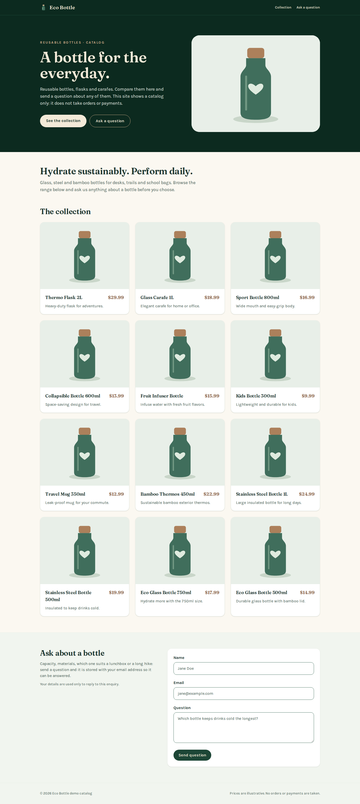
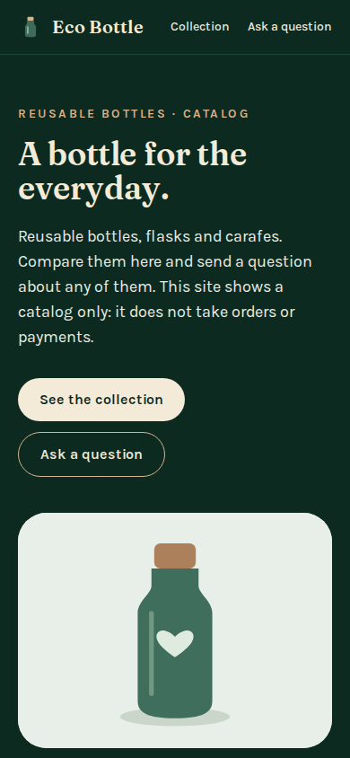
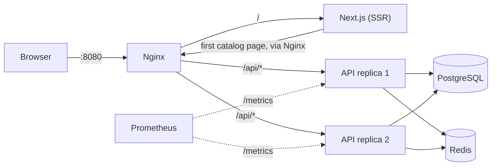

# Eco Bottle: a catalog and enquiry demo

A small storefront for reusable bottles: a Next.js page lists the catalog and takes product questions, and an Express + TypeORM API stores them in PostgreSQL, with Redis for caching, rate limiting and token revocation. Docker Compose runs two API replicas behind Nginx, plus Prometheus.

It is a catalog, not a shop. There is no cart, checkout, payment or order handling, and the twelve products are demo data.



| Mobile (390 px) | Enquiry sent |
| --- | --- |
|  |  |

## How a request flows



- The Next.js server fetches the first catalog page while rendering, so products are in the initial HTML. SWR revalidates it in the browser.
- Catalog reads go through a Redis read-through cache (60 s for lists, 300 s for a product) with a short lock so concurrent misses query Postgres once. Writes invalidate the cached pages.
- The enquiry form posts to `/api/leads`. Every question is stored, including repeat questions from the same address.

## Run it with Docker Compose

Requirements: Docker with the Compose plugin. Ports 8080 (site), 5432, 6379 and 9090 are bound to 127.0.0.1.

```sh
cp .env.example .env      # then fill in POSTGRES_PASSWORD, JWT_SECRET and SEED_USER_PASSWORD
make init                 # apply migrations, load the demo products and one account
make up                   # build and start everything in the background
```

Open http://localhost:8080. `./run.sh` does the same three steps in one go. `make down` stops the stack and keeps the data volumes. Remove them with `docker compose down -v` when you want a clean database.

`make init` can be run again safely. Migrations already applied are skipped, the seed updates the demo products in place, and it creates the seed account only if that email does not exist yet.

### Tests

```sh
make test
```

This builds the backend test image and runs typecheck, ESLint and the full suite against a throwaway Postgres and Redis (tmpfs, not published on any port). The current result is 21 tests passing. That covers 15 offline unit tests plus 6 integration scenarios: auth and token revocation, cached pagination and ETags, cache invalidation on writes, repeat enquiries and the rate limit, and seed idempotency.

## Local development without Docker

Node 22.13 or newer (`.nvmrc`). Each app has its own npm lockfile; there is no root install.

```sh
# API: needs Postgres and Redis running locally
cd apps/backend
npm ci
cp .env.example .env      # set DATABASE_URL and a JWT_SECRET of 32+ characters
npm run migrate           # build and apply migrations
npm run seed              # needs SEED_USER_PASSWORD (12+ characters) in .env
npm run dev               # http://127.0.0.1:4000, Swagger UI at /docs

# Frontend
cd apps/frontend
npm ci
cp .env.example .env.local
npm run dev               # http://localhost:3000
```

Checks per app: `npm run typecheck`, `npm run lint`, `npm test`. In the backend, `npm test` skips the integration suite unless `TEST_DATABASE_URL` and `TEST_REDIS_URL` point at disposable databases. The suite drops and recreates the `public` schema and flushes the Redis database it is given. `npm run build` in the frontend downloads the Fraunces and Karla fonts from Google Fonts.

New schema changes: edit the entities, then `npm run migration:generate -- src/migrations/DescribeTheChange` against a migrated database.

## API

The full contract is in [`apps/backend/openapi.yaml`](apps/backend/openapi.yaml), served at `/docs` on the API port.

| Endpoint | Purpose |
| --- | --- |
| `GET /api/products?page=1&limit=12` | Catalog page, newest first. `limit` is capped at 100. |
| `GET /api/products/:slug` | One product |
| `POST /api/leads` | Store an enquiry: `name`, `email`, `message`, optional `utmSource` |
| `POST /api/auth/register`, `POST /api/auth/login` | Local accounts; login returns a 15-minute HS256 token |
| `GET /api/auth/me`, `POST /api/auth/logout` | Bearer-token session; logout revokes the token in Redis |
| `POST/PUT/DELETE /api/products…` | Off unless `ENABLE_DEMO_PRODUCT_WRITES=true` (see below) |
| `GET /health`, `GET /ready`, `GET /metrics` | Liveness, Postgres + Redis readiness, Prometheus (API port only) |

Captured from the Compose stack (ids and timestamps vary):

```http
GET /api/products?page=1&limit=2

HTTP/1.1 200 OK
ETag: W/"VnV5y9mkTeX/1WzCQjVXjXNmYWU="
Server-Timing: db;dur=7, cache;desc="MISS"
RateLimit-Limit: 300
RateLimit-Remaining: 299

{"items":[{"id":"689e47b0-2887-41f2-9cbb-6ee8a3dece65","slug":"thermo-flask-2l","name":"Thermo Flask 2L",
  "priceCents":2999,"imageUrl":"/bottle-placeholder.svg","shortDescription":"Heavy-duty flask for adventures.",
  "createdAt":"2026-11-09T02:20:27.812Z","updatedAt":"2026-11-09T02:20:27.812Z"}, ...],
 "total":12,"page":1,"limit":2}
```

The same request a moment later answers from Redis with `Server-Timing: cache;desc="HIT"`. Sending the ETag back as `If-None-Match` returns `304`.

```http
POST /api/leads
{"name":"Demo Person","email":"demo.person@example.test","message":"Is the 2L flask dishwasher safe?","utmSource":"newsletter"}

HTTP/1.1 201 Created
{"id":"d929daaf-9936-4656-954c-84da8f3aeab5","createdAt":"2026-11-09T02:21:16.643Z"}
```

```http
POST /api/leads
{"name":"","email":"not-an-email","message":""}

HTTP/1.1 400 Bad Request
{"error":"ValidationError","details":{"formErrors":[],"fieldErrors":{"email":["Invalid email address"],
  "name":["Too small: expected string to have >=1 characters"],
  "message":["Too small: expected string to have >=1 characters"]}},"traceId":"3747ce2e-66da-428a-a19d-43cad58b7159"}
```

```http
POST /api/auth/register   {"email":"Reader@Example.test","password":"…"}
HTTP/1.1 201 Created      {"id":"81c8856c-21c5-4373-ab1e-265f5e4f1727","email":"reader@example.test"}

POST /api/auth/register   {"email":"reader@example.test","password":"…"}
HTTP/1.1 409 Conflict     {"error":"ConflictError","details":"Email already in use","traceId":"…"}

GET /api/auth/me          (Bearer token from /api/auth/login)
HTTP/1.1 200 OK           {"user":{"userId":"81c8856c-21c5-4373-ab1e-265f5e4f1727","email":"reader@example.test"}}

POST /api/auth/logout  -> 204, then GET /api/auth/me with the same token:
HTTP/1.1 401 Unauthorized {"error":"AuthError","details":"Token revoked","traceId":"…"}
```

## Design notes

- **Rate limits are per limiter and per client.** `/api/*` allows 300 requests a minute per address, and enquiries allow 5 a minute on top. Each limiter has its own Redis bucket, and the counter and its expiry are set in one `MULTI`. The client address is Express's `req.ip`. `X-Forwarded-For` only counts when `TRUST_PROXY` says how many proxies to trust (Compose sets `1` for Nginx), so a forged header cannot reset the limit.
- **Redis failures are bounded.** Commands give up after about a second instead of queueing. The cache then reads straight from Postgres and the rate limiter lets requests through. Token revocation fails closed: if Redis cannot confirm a token is not revoked, the request errors.
- **Product writes are off by default.** Any registered account could otherwise change the catalog, because there is no admin role. `ENABLE_DEMO_PRODUCT_WRITES=true` turns the endpoints on for a shared demo only.
- **Versioned schema.** `src/migrations/` holds the schema and `dist/migrate.js` applies it. Nothing relies on TypeORM's `synchronize`.
- **Low-cardinality metrics.** Request durations are labelled by route pattern (`/api/products/:slug`), not by raw path.
- **Login timing.** Unknown emails still pay for a bcrypt comparison, so response time does not reveal which accounts exist. Emails are stored lower-cased.
- **`?variant=b`** swaps the intro headline copy. It is a copy switch only; there is no experiment assignment or analytics.
- **Product images** can be a path under `apps/frontend/public`, an `https://res.cloudinary.com/...` URL or a Cloudinary public id. Other hosts render the placeholder, because `next/image` only loads hosts listed in `next.config.ts`.

## Configuration

| Variable | Where | Notes |
| --- | --- | --- |
| `POSTGRES_PASSWORD`, `JWT_SECRET` | root `.env` (Compose) | Required. Compose builds `DATABASE_URL` from the password, so use letters and digits. |
| `SEED_USER_EMAIL`, `SEED_USER_PASSWORD` | root `.env` | The account `make init` creates. Password of at least 12 characters. |
| `DATABASE_URL`, `REDIS_URL`, `JWT_SECRET` | `apps/backend/.env` | Local API development |
| `TRUST_PROXY` | API | `false` (default) or the number of proxy hops in front of the API |
| `ENABLE_DEMO_PRODUCT_WRITES` | API | `true` enables product create/update/delete for any signed-in account |
| `NEXT_PUBLIC_API_URL` | frontend build | Browser-facing API base, fixed at build time. Public, never a secret. |
| `INTERNAL_API_URL` | frontend runtime | API base used during server rendering |

## Limits and next steps

- No admin role or authorization model, so catalog editing stays a demo switch.
- Server-side rendering calls the API from the frontend container, so all first page loads share that container's rate-limit bucket (300 a minute).
- Enquiries have no retention policy, consent record or reply workflow.
- `tests/load.yml` is an Artillery scenario for the Compose stack (`npx artillery run tests/load.yml`). It has not been run, and no throughput figures are claimed.
- `prom-client` is marked deprecated in favour of `@prometheus-io/client`, which only reached its first releases in 2026; the switch is left for when it has a longer track record.

## License

[MIT](LICENSE)
